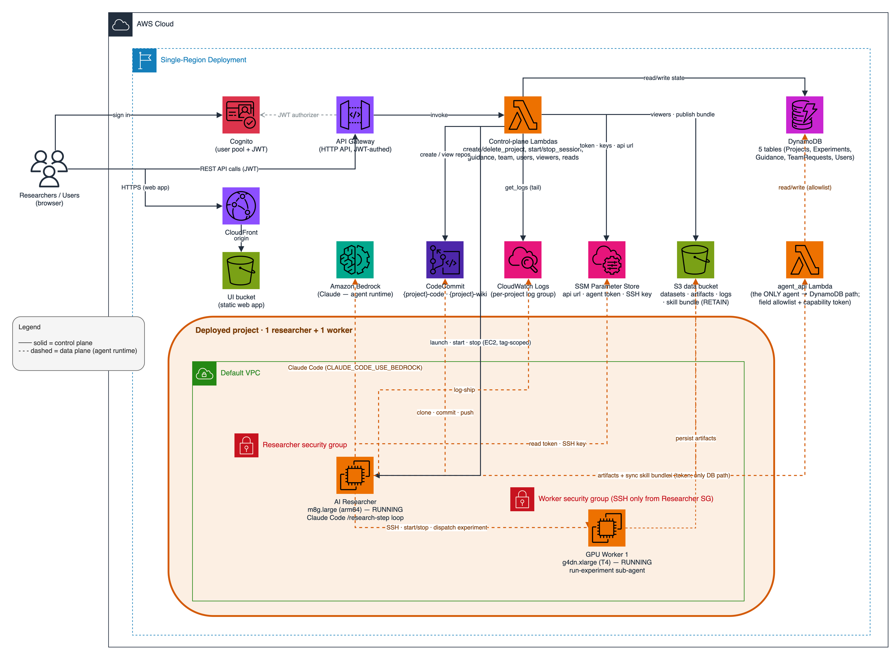

# AI Researcher Design

## Contents

- [AI Researcher Design](#ai-researcher-design)
  - [Contents](#contents)
  - [1. About this System](#1-about-this-system)
    - [Key design choices](#key-design-choices)
    - [The bootstrap-directory convention (how a project is defined)](#the-bootstrap-directory-convention-how-a-project-is-defined)
    - [Security \& access model](#security--access-model)
    - [Budgets](#budgets)
  - [2. Repository map — where to make a change](#2-repository-map--where-to-make-a-change)
  - [3. The five CDK stacks (`infrastructure/`)](#3-the-five-cdk-stacks-infrastructure)
  - [4. Control-plane Lambdas \& the agent↔DB boundary (`infrastructure/lambda/`)](#4-control-plane-lambdas--the-agentdb-boundary-infrastructurelambda)
  - [5. Runtime flow (the data plane, once a project is `active`)](#5-runtime-flow-the-data-plane-once-a-project-is-active)
    - [The agent skills](#the-agent-skills)
  - [6. Build \& deploy workflows (`scripts/`)](#6-build--deploy-workflows-scripts)
  - [7. Web app (`user-interface/src/`)](#7-web-app-user-interfacesrc)
  - [8. Observability (CloudWatch log streams)](#8-observability-cloudwatch-log-streams)
  - [9. Data \& State model](#9-data--state-model)
    - [`AutoResearch-Projects` — PK `project_id`](#autoresearch-projects--pk-project_id)
    - [`AutoResearch-Experiments` — PK `project_id`, SK `experiment_id`](#autoresearch-experiments--pk-project_id-sk-experiment_id)
    - [`AutoResearch-Guidance` — PK `project_id`, SK `guidance_id`](#autoresearch-guidance--pk-project_id-sk-guidance_id)
    - [`AutoResearch-Users` — PK `user_sub`](#autoresearch-users--pk-user_sub)
    - [`AutoResearch-TeamRequests` — PK `project_id`, SK `user_sub`](#autoresearch-teamrequests--pk-project_id-sk-user_sub)
  - [10. Invariants \& conventions — do not break these](#10-invariants--conventions--do-not-break-these)
  - [11. Fast path to a first change](#11-fast-path-to-a-first-change)

## 1. About this System



This is an autonomous **AI Researcher**: you upload a "bootstrap directory" describing a research problem
(code to optimize + how to score it), and a Claude Code agent running on EC2 loops
**hypothesize → run an experiment on a GPU → learn → update its wiki → repeat**, streaming
everything to a React dashboard. The repo is one self-contained deployable: **AWS CDK
infrastructure**, the **agent runtime** (bash + Claude Code skills), and the **web app**.

There are two distinct planes; keep them straight, because most mistakes come from confusing them:

- **Control plane** — the CDK stacks, the Lambdas, and the web app. Cheap, always-on, user-facing.
  Owns provisioning, auth, reads, and human actions (start/stop/guidance/delete).
- **Data plane** — the agent itself, running on EC2 (a cheap CPU "researcher" + on-demand GPU
  "workers"). It does the actual research. It reads/writes S3 and CodeCommit directly, but it
  **may not touch DynamoDB directly** — it goes through the `agent_api` Lambda (see §4).

### Key design choices

A run is driven by a **single AI Researcher** on a cheap, always-available CPU instance
(`m8g.large`, Graviton/arm64 — the researcher is pure CPU reasoning, so it takes the cheaper arm64;
the boot's AMI + awscli download follow the instance architecture) that does all the thinking —
reading results, forming hypotheses, editing code — and
**offloads only the actual training runs to GPU worker nodes that it powers on and off on demand**.
There is deliberately no fleet of researchers and no separate orchestrator: concurrency, when
wanted, comes from the one researcher dispatching one experiment per available worker. Keeping the
expensive GPUs off except while a run is executing is the core cost lever — the reasoning is cheap,
the compute is not.

**Why EC2 workers rather than SageMaker training jobs.** These are *experimental* jobs authored by
a coding agent: the code is expected to fail — wrong tensor shapes, OOMs, dependency mismatches,
silent NaNs — and the value comes from a **tight edit → run → inspect → fix cycle** on a live box.
A coding agent needs to SSH in, read a traceback, patch a file, and re-run within seconds. A managed
training job has the opposite ergonomics: each attempt is a package → queue → provision → teardown
round trip, logs arrive after the fact, and there is no live shell to debug in. A persistent EC2
instance instead gives the agent an interactive workstation with a fast debug loop. Two mechanisms
keep that cheap and safe:

- the worker is **stopped by default and started only while an experiment runs** (the run-experiment
  sub-agent does Start → run → Stop), so an idle project spends nothing on the GPU; and
- **one-time setup cost is paid once**: `setup.sh` installs deps and stages the dataset/checkpoints
  onto the instance's EBS volume on first boot, then the worker **powers itself off** — so after
  `auto_start` only the researcher stays up. That EBS volume **survives stop/start**, so every later
  experiment (woken on demand by the sub-agent) skips the multi-GB download and starts immediately.

Other choices follow the same "cheap, debuggable, reversible" grain:

- **Claude Code on Bedrock as the agent runtime — not a bespoke agent.** Both the researcher and
  the run-experiment sub-agent are Claude Code processes (routed through Amazon Bedrock), not a
  custom agent loop we wrote. This is deliberate: hand-rolling a research agent would mean
  reimplementing exactly what Claude Code already does well — **authoring and editing code, reading
  tracebacks and debugging runtime failures, driving `git` to keep every change under version
  control, and running the bash shell efficiently** (long-running commands, streamed output,
  timeouts). We get that for free and spend our effort only on the research-specific behavior. **We
  steer it entirely through skills** — `research-step`, `run-experiment`, `knowledge-acquisition`, and `web-search`.
  A skill is a prompt-plus-procedure in Markdown (`SKILL.md`) paired with a `scripts/` directory of
  small bash helpers it calls, so changing how the researcher behaves is *editing text, not rewriting
  an agent* (the skills and their scripts are detailed in §5). They are delivered to each instance's
  HOME (`~/.claude/skills/`) from a shared S3 bundle at boot and load as personal skills.
  Iterations are **bounded `claude -p /research-step` calls** rather than one long-lived session, so
  the model context cannot grow unbounded across thousands of experiments — durable memory lives in
  the LLM Wiki, the status report, and the experiments ledger, re-read every iteration (see §5).
- **The LLM Wiki as a compounding, human-navigable knowledge context.** The agent maintains a
  hyperlinked Markdown wiki (the separate `{project}-wiki` git repo) as its long-term memory —
  concepts, entities, comparisons, and findings, cross-linked with `[[wikilinks]]`. It serves two
  purposes at once. First, it is an **efficient, curated context for the agent**: rather than
  re-deriving background or trying to hold everything in the context window, each `research-step`
  reads the compact, distilled wiki it has been building, so scientific knowledge **compounds across
  iterations** instead of being lost when a bounded session ends. Second, it is **navigable by
  humans**: the web app renders the same repo as a browsable wiki with hyperlinks, backlinks, and a
  force-directed graph (§7), so a person can follow what the researcher understands, see what it has
  learned, and audit the reasoning trail. The `knowledge-acquisition` skill feeds it — literature
  search, paper download, and summarization — so the wiki grows from real sources, not just the
  model's priors.
- **A serverless, always-on control plane** (Lambda + DynamoDB + S3 + CloudFront) that scales to
  ~zero cost when no project is running, so Auto-Research can sit deployed indefinitely between projects.
- **Git (CodeCommit) as the substrate for both code and wiki.** Each experiment is a branch and a
  diff, the reasoning trail is versioned, and the web app renders history/diffs and wiki pages
  directly from the repos.
- **Full observability via CloudWatch.** Every instance streams its logs to CloudWatch —
  the **main researcher** loop *and* each **GPU worker** are fully logged (boot, dependency install,
  bundle sync, clone, the research loop, and each experiment's run), each on its own stream under one
  per-project log group (§8). Nothing runs unobserved: the web app tails these streams live and full
  logs are archived to S3, so you can watch the agent think and audit any run after the fact.
- **A hard agent↔DB boundary** (§4): the agent holds no DynamoDB permissions and mutates state only
  through the `agent_api` Lambda's whitelisted actions — least privilege for a process that runs
  agent-authored code.
- **Convention over configuration:** nothing about a project is hard-coded (see the
  bootstrap-directory convention below), so onboarding a new research problem is a folder upload, not
  a code change.
- **Layered cost/safety guardrails:** a guaranteed worker stop on sub-agent exit, a worker-side
  shutdown watchdog, a per-project `budget_usd` cap, and a Stop button that halts all compute.

### The bootstrap-directory convention (how a project is defined)

Nothing about a project is hard-coded into Auto-Research: a project is a **bootstrap directory** the
user uploads in the web app. Its contents are committed to the project's code repo and the agent
runs against them. Any folder that follows this convention is picked up.

```
<project>/                     # folder name → slugified project id
├── auto-research.json         # REQUIRED — the machine-readable spec (fields below)
├── README.md                  # REQUIRED — the researcher's brief (goal, background, seed refs, ideas)
├── src/                       # REQUIRED — the code/artifacts under study
│   ├── <files to optimize>          # listed in modifiable_files (agent may edit)
│   └── <fixed harness, deps>        # listed in read_only_files (agent may NOT edit)
└── setup.sh                   # OPTIONAL — one-time worker setup (install deps, stage data on EBS)
```

`auto-research.json` holds the machine-read spec:
`description` (a short one-line summary for the projects list + homepage — not the full brief),
`modifiable_files`,
`read_only_files` (→ `.claude/settings.json` deny-rules so the agent physically cannot edit them),
`evaluation_command` (runs one experiment; must write `metrics.json` — at least `{"metric": <number>}`
plus optional `peak_vram_mb`/`status`/`notes` — and typically also redirects console output to
`run.log`), and `metric_name` / `metric_direction` (the objective + direction). The result JSON must
be written by the read-only evaluation harness so the agent cannot fabricate the score; if it is
absent/invalid the run is scored as a crash (no fallback). Everything the researcher *reads*
— goal, background, seed references, starting ideas — lives in **`README.md`**, which is inlined into
the agent's CLAUDE.md and seeds the wiki. The project **name**, **model**, **budget**, **training time
budget**, and **experiment timeout** are entered in the *Create New Project* form at creation time —
not in these files. `create_project` always generates `CLAUDE.md` (from the README brief + spec) and
seeds the wiki from the README. It injects `time_budget_seconds` (form value, default 300) into the
committed `auto-research.json` as the training time budget the agent's code self-enforces;
`experiment_timeout_minutes`
(default 15) is stored in the project record and enforced at dispatch (the dispatch step wraps the
run-experiment sub-agent in a `${mins}m` timeout).

The **user provides** the project + code under study. At creation Auto-Research commits that upload to
`{project}-code` (adding only `CLAUDE.md` and `report/status.md`) and seeds a separate `{project}-wiki`
repo. The managed runtime — `.claude/skills/`, the `.auto-research/` scripts, and the
per-project `.claude/settings.json` — is **not** committed to the code repo: it is published to a
shared S3 bundle and synced onto each instance's HOME at boot (§5, §6). So `{project}-code` stays
exactly the research artifact, and the agent runtime lives in HOME. Fit for the agent requires two
things of the problem: a candidate is a **machine-representable artifact** (code/config/params) and
can be **scored programmatically**. The ready-made examples in `demos/` are complete worked instances
of this convention.

### Security & access model

**Authentication.** The web app authenticates against a Cognito user pool, and every HTTP API route
sits behind a Cognito JWT authorizer — so each call carries a verified identity (the user's `sub` and
`username`).

**Per-project authorization.** Each project records an **`owner`** (its creator) and an **`admins`**
map. Any authenticated user may **read** any project — Auto-Research is a shared read space (project
list, code, wiki, data, logs). **Write** actions (start/stop the session, submit guidance) require the
caller to be the owner or an admin. **Deleting** a project is owner-only. Any user can request to join
a project's team; an owner or admin admits them, which makes them an admin. Each Lambda enforces this
from the JWT identity (helpers in the `ar_authz` layer); the UI mirrors it (an Owner/Admin badge or a
"Join the team" button, and controls shown only to owner/admin), but the server is the gate.

**Per-project resource isolation.** Each project's researcher and worker instances run under their
**own** IAM role and instance profile (`auto-research-proj-{project_id}`), created at provisioning
under a **permissions boundary** that caps what any project role can ever do. The role is scoped to
that one project: its S3 prefix `{project_id}/`, its two CodeCommit repos, its log group, and its own
SSM parameters. Each project also has its **own SSH keypair** (private key in a per-project SSM
parameter). Because a project box runs intentionally-untrusted user- and agent-authored code, this
scoping is what confines a compromise: a box can read and write only its own data, repos, and key —
never another project's.

**Agent↔DB boundary + caller binding.** Instances hold **no** DynamoDB permissions. All
project/experiment/guidance state is read and written only through the `agent_api` Lambda, which
enforces a field allowlist (`PROJECT_WRITABLE`) and a `status` enum. `agent_api` binds every call to
the project it names via a **per-project capability token**: the token lives in that project's own SSM
parameter (readable only by its role) and in the project record; a call must present the matching
token, so one project's box cannot mutate another project's state, and the token is never returned to
instances.

**Provisioning guardrails.** The Lambda that mints project roles may create roles only under the
`/auto-research/projects/` path and only with the permissions boundary attached, and may pass a role
only to EC2 — so it cannot produce a privileged role. Teardown is tag/name-scoped: it terminates only
`ManagedBy=auto-research` instances and deletes only `auto-research`-named repos and log groups, and
validates the project-id slug before building any resource name.

**Input & output handling.** The S3 viewers containment-check the requested key/prefix (rejecting
`..` and absolute paths), so a read stays inside the project prefix. Agent- and repo-authored markdown
(wiki pages, the status report, log narration) is rendered without raw HTML and with a minimal URL
allowlist, so stored content cannot inject script. API responses return generic error messages (detail
is logged server-side). CORS is restricted to the web app's origin. DynamoDB tables have
point-in-time recovery; the data and UI buckets block public access and enforce TLS.

### Budgets

Cost is capped **per user**. Each user has a **budget** — a spendable USD balance stored in
`AutoResearch-Users` (`budget`). Every user starts at **$0**; a budget-administrator grants budget.

- **Creating a project** reserves the project's **maximum budget** (`budget_usd`) from the creator's
  budget: `create_project` requires `budget_usd > 1` and atomically decrements the owner's balance
  (`SET budget = budget − M` conditioned on `budget >= M`), rejecting with an insufficient-budget
  error otherwise. The project is stamped `budget_reserved = true`. The `budget` balance *is* the
  available amount — an active project's reservation has already been subtracted.
- **Deleting a project** refunds the unspent part to the owner: `delete_project` adds
  `max_budget − min(spent, max_budget)` back to `budget` (only for `budget_reserved` projects, so
  projects created before budgeting neither reserve nor refund).
- **Budget-administrators** (`AutoResearch-Users.is_budget_admin`) can list every user's budget and
  set any user's budget. Regular users can only read their own. This is separate from the per-project
  owner/admin model. Editing is done through the `users` Lambda (§4).

---

## 2. Repository map — where to make a change

```
aws-auto-research/
├── README.md                 # end-user documentation + deploy guide
├── design.md                 # ← this file
├── demos/                    # ready-to-upload bootstrap dirs (see demos/README.md for the current set)
│   └── README.md             #   demo index (GPU/worker sizing notes live ONLY here)
├── researcher/               # CANONICAL SOURCE for the agent runtime (CPU researcher instance)
│   ├── aws_auto_research/     #   the `aws-research` CLI + library: boot, research loop, experiment runners,
│   │                         #   control-plane client, spend accounting, log shipping
│   ├── pyproject.toml         #   package metadata + the `aws-research` entrypoint
│   ├── tests/                 #   unit tests for the library
│   └── .claude/skills/       #   the agent's skills — synced to HOME (~/.claude/skills) at boot, load as personal skills (§5)
│       ├── research-step/        SKILL.md — one research iteration (design → dispatch → learn → update wiki/report)
│       ├── run-ec2-experiment/   SKILL.md — sub-agent protocol on a GPU worker (start→run→debug→stop→report)
│       ├── run-local-experiment/ SKILL.md — sub-agent protocol on the researcher's own GPU (local runner)
│       ├── scientific-paper-writing/  SKILL.md + templates/ (IEEEtran) — write the IEEE-conference paper (LaTeX→PDF) when research completes (opt-in)
│       ├── knowledge-acquisition/  SKILL.md + scripts/ — the "LLM Wiki" skill (literature search/download)
│       └── web-search/           SKILL.md + search.py — web/arXiv/GitHub search and page/PDF reader (Bedrock-safe)
├── worker/
│   └── bootstrap.sh          # CANONICAL SOURCE for the GPU worker boot (runs the project's setup.sh once)
├── infrastructure/           # AWS CDK app (Python)
│   ├── app.py                #   wires the 5 stacks (see §3)
│   ├── stacks/*.py           #   DataStack, AuthStack, ComputeStack, ApiStack, WebAppStack
│   └── lambda/<name>/handler.py   # control-plane Lambdas (see §4)
│       └── create_project/seed/   # BUILD ARTIFACT (gitignored) — see §6, do not edit by hand
├── user-interface/           # React + Vite + Cloudscape web app (see §7)
└── scripts/                  # deploy.sh, package_lambdas.sh, deploy_ui.sh
```

**Rule of thumb for "where do I edit?"**

| To change… | Edit… | Then… |
|---|---|---|
| Agent behavior / a skill | `researcher/.claude/skills/<name>/SKILL.md` | re-package + redeploy API stack (§6) |
| Researcher boot/loop/runners | `researcher/aws_auto_research/` (the `aws-research` CLI); worker boot: `worker/bootstrap.sh` | re-package + redeploy API stack (§6) |
| A control-plane endpoint | `infrastructure/lambda/<name>/handler.py` + a route in `api_stack.py` | `cdk deploy AutoResearchApiStack` |
| IAM / VPC / instance role | `infrastructure/stacks/compute_stack.py` | `cdk deploy AutoResearchComputeStack` |
| DynamoDB / S3 shape | `infrastructure/stacks/data_stack.py` | `cdk deploy AutoResearchDataStack` (tables are `RemovalPolicy.DESTROY`; see §3) |
| Web app UI | `user-interface/src/**` | `bash scripts/deploy_ui.sh` (§6) |
| UI↔API contract | `user-interface/src/services/api.ts` (types + fetchers) | keep in sync with the Lambda that serves it |

**`infrastructure/lambda/create_project/seed/` is generated, not hand-edited.** `package_lambdas.sh`
regenerates it from the canonical `researcher/` and `worker/` sources, so an edit made directly in
`seed/` is overwritten on the next build. Make every agent-runtime change in `researcher/`/`worker/`
and repackage (§6).

---

## 3. The five CDK stacks (`infrastructure/`)

Deployed by `cdk deploy --all` (via `scripts/deploy.sh`). The deploy region comes from
`$AWS_REGION` / `$CDK_DEFAULT_REGION` and defaults to **`us-east-1`** (best GPU capacity + Bedrock
inference-profile availability); you can deploy to any region your account supports — just pick one
and use it consistently (§6 covers region resolution; §10 the single-region invariant).

- **DataStack** — 5 DynamoDB tables + 1 S3 bucket (all tables have point-in-time recovery).
  - `AutoResearch-Projects` (PK `project_id`) — project registry + live session state.
  - `AutoResearch-Experiments` (PK `project_id`, SK `experiment_id`) — experiment ledger.
  - `AutoResearch-Guidance` (PK `project_id`, SK `guidance_id`) — human→agent inbox.
  - `AutoResearch-TeamRequests` (PK `project_id`, SK `user_sub`) — pending "join the team" requests.
  - `AutoResearch-Users` (PK `user_sub`) — per-user budget + budget-admin flag (§ Budgets).
  - Bucket `auto-research-{account}-{region}` — **explicitly named** (the instance-role policy
    references that ARN) and **`RemovalPolicy.RETAIN`** (survives `cdk destroy`). Tables are
    `DESTROY` — a `cdk destroy` wipes project/experiment state, so don't casually recreate them.
- **AuthStack** — Cognito user pool + client + identity pool. The HTTP API attaches a Cognito JWT
  authorizer to every route; handlers read the caller's `sub` + `username` from the JWT to authorize
  per-project actions (owner/admins — see Security & access model).
- **ComputeStack** — shared networking: default-VPC lookup and two security groups (researcher SG;
  worker SG that only allows SSH *from* the researcher SG). Project instances do **not** share an
  identity — each project runs under its own IAM role/instance profile minted at provisioning.
- **ApiStack** — the HTTP API Gateway (JWT-authed) + all control-plane Lambdas and their routes
  (§4). Defines the **project-role permissions boundary** and the `create_project` least-privilege
  policy: EC2 launches are scoped by the `ManagedBy=auto-research` tag; role minting is confined to
  the `/auto-research/projects/` path with the boundary attached; PassRole is EC2-only. Each project
  role it mints grants Bedrock invoke, that project's S3 prefix + its two CodeCommit repos + its log
  group + its SSM parameters, SSM Session Manager, `ec2:DescribeTags`/start/stop (tag-scoped), and
  **`lambda:InvokeFunction` on exactly `AutoResearch-agent_api`** (the DynamoDB gateway — §4) —
  with **no DynamoDB permissions**.
- **WebAppStack** — the UI S3 bucket + CloudFront distribution. `deploy_ui.sh` reads its outputs.

---

## 4. Control-plane Lambdas & the agent↔DB boundary (`infrastructure/lambda/`)

Grouped by purpose:

- **Provisioning:** `create_project` (fast API path + async self-invoke that streams provisioning
  progress; commits the seed bundle into `{project}-code`, seeds `{project}-wiki`, launches 1
  researcher + N workers **STOPPED**, tagged `ManagedBy=auto-research`), `delete_project` (same
  two-mode shape: fast API path marks the project `deleting` + self-invokes the async teardown and
  returns 202; the teardown terminates instances, deletes repos, log group, the S3 prefix — which can
  be tens of thousands of objects — and DB rows, with no API Gateway 29s cap).
- **Human actions (owner/admin only):** `start_session` / `stop_session` (start/stop the researcher
  instance and flip `status` active↔paused), `submit_guidance` (append to the Guidance inbox; also
  toggles `write_paper`). Each loads the project and rejects a caller who is not the owner or an
  admin. `delete_project` is owner-only.
- **Team:** `team` manages the owner/admins/join-requests — request to join (any authenticated user),
  list requests / admit a requester as admin (owner/admin), remove an admin (owner).
- **Users & budgets:** `users` — `GET /me` returns the caller's budget row (lazy-created at $0); the
  budget-admin routes `GET /users` (all pool users ⋈ budgets, via Cognito `ListUsers`) and
  `PUT /users/{sub}/budget` (set a user's budget). `create_project` reserves budget and
  `delete_project` refunds it (§ Budgets).
- **Reads for the web app:** `get_experiments` (also serves `GET /projects`), `get_workers` (live
  EC2 power state per worker), `get_logs` (CloudWatch tail), and the viewers `wiki_viewer` /
  `code_viewer` (CodeCommit tree/file/commits/diff) / `data_viewer` (S3 tree/presigned-url/preview).
- **`agent_api` — the agent's only DynamoDB path.** Invoked **directly** by the EC2 instance role
  (`aws lambda invoke`, *not* through API Gateway — it has no route). Owns all read/write on the
  three tables. Actions: `get_project`, `list_experiments`, `get_guidance` (unprocessed only),
  `create_experiment`, `update_experiment`, `update_project`, `mark_guidance_processed`. Responses
  are `{"ok": true, ...}` / `{"ok": false, "error": ...}`.

  **Field allowlist:** `update_project` only accepts fields in `PROJECT_WRITABLE = {best_metric,
  spent_usd, researcher_cost_usd, status, paper_pdf_s3_uri}` (and `status` must be a valid lifecycle
  enum value). If the agent legitimately needs to write a new project field, add it to that set on
  purpose — don't work around it.

  **Caller→project binding:** every call must present the project's **capability token** (`_token`);
  `agent_api` compares it to the token on the project record and rejects a mismatch, so a box can act
  only on its own project. The token is stripped from `get_project` responses.

  The agent side of this boundary is the control-plane client (`aws-research api` / the
  `ControlPlaneClient`): it builds the payload, attaches the token from the instance's environment,
  invokes the function, and returns the result. Skills and the loop call *that*, never DynamoDB.

**Two contracts to keep in sync when you touch an endpoint:**
1. `api_stack.py` `routes` list (path + method + integration + the Lambda) — and the matching IAM
   grant on that Lambda.
2. `user-interface/src/services/api.ts` — the typed fetcher + the TS interface for the payload.
   `api.ts` is the single source of truth for the UI↔API shape; the `Project`/`Experiment` types
   there mirror the DynamoDB item shape.

---

## 5. Runtime flow (the data plane, once a project is `active`)

```
create_project ─▶ async provisioning: commit repos, launch researcher + N workers (running), then
   finish at status='active' (auto_start, DEFAULT) — the still-booting researcher reads 'active' and
   runs its loop directly; NO manual Start. [auto_start=false → status='setup': the researcher
   self-stops after boot; press Start (start_session: EC2 StartInstances(researcher) + status='active')]
        │
EC2 boot (systemd oneshot): the pre-boot launcher installs the `aws-research` library, clones
   {project}-code and SYNCS the runtime bundle from S3 into HOME (~/.claude/skills), writes
   ~/.claude/settings.json, then execs `aws-research researcher boot`
`aws-research researcher boot` (idempotent via marker)
   first boot: install Claude Code + uv, git-remote-codecommit; clone {project}-code & {project}-wiki
   every boot: git pull; then run `aws-research researcher loop`, piping all output through
   `aws-research log-ship` (a separate process → CloudWatch stream + local archive)
        │
`aws-research researcher loop`  (loops while agent_api get_project.status == 'active')
   each iteration: BUDGET GUARD (pause if spent_usd >= budget_usd) + PATIENCE GUARD (pause if the last
   `patience` steps kept nothing); git pull code+wiki; run a BOUNDED `claude -p` of /research-step
   (stream-json, bypassPermissions, budget + turn caps); then PERSIST STATE (commit + push the code +
   wiki working trees) and RECORD SPEND (spent_usd = sum of the ledger's cost_usd + researcher_cost_usd)
        │
/research-step skill: read wiki+report+ledger → design one experiment → create_experiment(running)
   → dispatch a run-<runner>-experiment sub-agent per available worker → learn → update wiki + report/status.md
   → finalize experiment (kept|discarded|crashed, incl. computed cost_usd) → keep-best → update_project(best_metric)
        │
run-<runner>-experiment sub-agent: EC2 Start the assigned worker → SSH in → run the evaluation_command
   within time_budget → persist artifacts to S3 → EC2 Stop the worker → report (local runner: runs on
   the researcher's own GPU, no worker/SSH)
        │
Human presses Stop ─▶ stop_session flips status to 'paused'; the loop sees not-'active', exits;
   `aws-research researcher boot` runs `shutdown -h now`. GPU is on ONLY while an experiment runs.
```

**Start is automatic by default.** `create_project` accepts `auto_start` (default `true`): provisioning
ends at `status=active`, so the just-launched researcher goes straight into its loop with no separate
`start_session` step (and no window in which a human could press Start while the instance is still
finishing its first boot). The Create-Project form exposes a
**"Start automatically"** checkbox (default on); unchecking it (or `auto_start:false` via the API)
leaves the project in `setup` (researcher self-stops after boot) until a human presses Start. Trade-off:
with the default on, spend begins as soon as the project provisions — the checkbox is the cost gate.

**Why iterations are bounded `claude -p` calls:** the Claude context must not grow unbounded across
thousands of experiments. Persistent memory lives in the **wiki**, the **status report**, and the
**experiments ledger** — `/research-step` re-reads them every iteration. Treat those three as the
agent's durable state; the per-iteration context is disposable.

### The agent skills

The data-plane logic lives in Claude Code skills under `researcher/.claude/skills/` (the canonical
source; §2), synced into `~/.claude/skills/` at boot and loaded as personal skills. Each skill is a
declarative `SKILL.md` — the prompt + step-by-step procedure the agent follows. The mechanical work
(control-plane reads/writes, git branch/commit/merge, S3, SSH to a worker) is the tested `aws-research`
CLI: the skill's steps invoke `aws-research step <cmd>` and `aws-research runner <cmd>`, and the
research loop invokes `aws-research dispatch-all`. So changing agent behavior is editing Markdown; the
Python library does the IO.

- **`research-step`** — one full iteration of the main loop, run by the researcher: sync context,
  drain guidance, grow the wiki, design one experiment per worker, branch + implement each, dispatch
  them all, then analyze → keep the best → finalize → report. Its control-plane and git/S3 steps are
  `aws-research step` subcommands (`pull-context`, `experiment-branch`/`experiment-push`,
  `create-experiment`, `dispatch-experiments`, `finalize-experiment`, `keep-best`, …). The budget +
  patience guards and the end-of-step commit+push of both repos are done by the loop around each
  `claude -p` step, not by the skill.
- **`run-ec2-experiment` / `run-local-experiment`** — the sub-agent protocol, and the only component
  that touches a GPU worker (ec2) or the researcher's own GPU (local): start the assigned worker (ec2
  only), run + debug the `evaluation_command` within the budget, persist artifacts, stop the worker,
  and return a structured result via `metrics.json`. Each step is an `aws-research runner <cmd>` call;
  the runner is selected per project by `experiment_runner`.
- **`knowledge-acquisition`** — the LLM Wiki skill: literature-search, paper-download, and
  summarization scripts (Python, run via `uv run`) that feed the wiki from real sources. It is
  self-contained and autonomous (no web app or hosting dependency).
- **`web-search`** — a stdlib-only script (`search.py`) for web, arXiv and GitHub search and for reading
  pages/PDFs as text. It replaces Claude Code's built-in WebSearch/WebFetch, which are unreliable when
  Claude runs through Bedrock. It only fetches public http(s) URLs.

**Context reaches the instance via tags + SSM**, not user-data args: the boot process reads
`ProjectId` / `Role` / `Model` from `ec2:DescribeTags`, and the API URL + this project's agent token
from SSM, then passes them — with `CLAUDE_CODE_USE_BEDROCK=1`, which routes Claude Code through
Bedrock — into the loop's environment, which every `claude -p` sub-agent inherits.

**Cost/safety guardrails (don't remove without a replacement):** workers self-stop after their
first-boot setup (so `auto_start` leaves only the researcher running), a guaranteed worker `stop` on
sub-agent exit, a worker-side shutdown watchdog, a per-project `budget_usd` cap, a `patience` stall
guard (stop after N steps with no improvement), and the Stop button that halts all compute.

---

## 6. Build & deploy workflows (`scripts/`)

- **`deploy.sh`** — full control-plane deploy. Runs `package_lambdas.sh`, creates/refreshes the CDK
  venv, `cdk bootstrap` if needed, `cdk deploy --all`, and stores the API URL in SSM. Idempotent.
- **`package_lambdas.sh`** — rebuilds `infrastructure/lambda/create_project/seed/` from the canonical
  `researcher/` + `worker/` sources. At project creation `create_project` publishes this seed to a
  **shared S3 bundle** (`s3://{bucket}/_platform/bundle/`), and each instance's pre-boot launcher
  **syncs it into HOME** (`~/.claude/skills/`, `~/.auto-research/`). So the agent runtime is delivered
  out-of-band and `{project}-code` stays exactly the research artifact. Each skill is a directory
  containing `SKILL.md` (a bare `.claude/skills/<name>.md` is not discovered), and skills load as
  personal skills from `~/.claude/skills/`. After editing anything under `researcher/` or `worker/`,
  re-run `package_lambdas.sh` and redeploy `AutoResearchApiStack` (or `deploy.sh`): the bundle is
  (re)published the next time a project is created, so new projects get the change at creation and
  existing projects re-sync the shared bundle on their next boot.
- **`deploy_ui.sh`** — writes `user-interface/.env.local` from stack outputs, `npm run build`, syncs
  to the UI bucket, invalidates CloudFront. Typical UI edit loop: `tsc --noEmit` then this.

Users are provisioned directly in the Cognito user pool (AWS console or `cognito-idp` admin APIs).

**Region resolution.** Every script resolves the target region from `$AWS_REGION` (falling back to
`aws configure get region`), and the stacks live in their deploy region. Export `$AWS_REGION` to your
deploy region before running any script (`export AWS_REGION=<deploy-region>`) so that deploy, SSM, and
UI-env commands all target the same region — a mismatch surfaces as a "stack does not exist" error.
This is the single-region invariant in §10.

---

## 7. Web app (`user-interface/src/`)

React + Vite + **Cloudscape** components, AWS Amplify for Cognito auth.

- **Routing** (`App.tsx`): `/` home, `/user`, `/projects/new`, and `/projects/:projectId` wrapping
  `ProjectLayout` with tab child routes: index=`StreamView` (Researcher Stream), `status`
  (`StatusView`), `experiments` + `experiments/:experimentId`, `wiki`, `code`, `data`, `paper`
  (`PaperView` — a native-browser PDF embed of `$S3/paper/paper.pdf`, shown only when
  `paper_pdf_s3_uri` is set), and `team` (owner/admin only). The top nav shows the signed-in
  **username** (from `GET /me`) linking to the User page, next to Sign out.
- **`pages/UserPage.tsx`** (`/user`) — the account page: **My Budget** (available USD), **My
  Projects** (the projects the caller owns, with each project's max budget + spend), and — for
  budget-admins — an **all-users table** with inline budget editing (`PUT /users/{sub}/budget`).
- **`pages/CreateProjectPage.tsx`** — the create form shows the caller's available budget and
  validates the project **budget** field (`> 1` and `≤ available`) before enabling submit.
- **`components/ProjectLayout.tsx`** — the project shell: header summary (session status + inline
  Start/Stop, live GPU worker states, best metric, spend, model), provisioning/failure views, and
  the tab bar. Polls `get_project` while provisioning and `get_workers` while active.
- **`components/LogFeed.tsx` + `lib/logFormat.tsx`** — the live log tail. `get_logs` is a
  forward-cursor tail (pass the previous `next_start`). Log lines are Claude Code **stream-json**
  objects; `logFormat.tsx` `renderLogMessage` turns each into a compact row by `obj.type`
  (`assistant` text/thinking/tool_use, `user` tool_result, `system` init/task_*/vcs, `result`,
  `tool_progress` heartbeats). Add a case here to surface a new event type. The log shipper
  (`aws-research log-ship`) drops only `thinking_tokens` spam; everything else is shipped verbatim and
  parsed client-side.
- **`pages/StatusView.tsx`** — renders `report/status.md` (from the code repo) with `react-markdown`;
  resolves `report/*.png` charts to presigned S3 URLs; renders `[[wikilinks]]` as links into the wiki.
- **`pages/WikiPage.tsx` + `lib/wikiModel.ts` + `lib/wikilinks.ts`** — client-side wiki. `wikiModel`
  crawls the `{project}-wiki` repo (folder-at-a-time), parses frontmatter/headings into pages keyed
  by `bySlug`/`byPath`, and builds the link graph (force-directed Graph tab). `[[name]]` links are
  rewritten to `[name](wiki:<slug>)` and resolved via `resolveWikiLink`.

**Custom `wiki:` link scheme.** Markdown is rendered with react-markdown@9, whose default
`urlTransform` sanitizes hrefs to a standard-protocol allowlist (`http`/`https`/`mailto`/…). Wikilinks
use a custom `wiki:` scheme, so both `StatusView` and `WikiPage` pass a `urlTransform` that lets it
through: `urlTransform={(url) => (url.startsWith('wiki:') ? url : defaultUrlTransform(url))}`. Any new
custom link scheme added to markdown needs the same passthrough.

---

## 8. Observability (CloudWatch log streams)

One log group per project: `/auto-research/{project_id}`. Streams:

- `provisioning` — `create_project`'s streamed provisioning steps (queued→…→done|failed).
- `boot` — instance boot (deps, bundle sync, clone, bootstrap). The Researcher Stream tab tails
  this (it's a superset that continues into the loop).
- `researcher-<instance_id>` — the researcher loop (stream-json).
- `worker-<instance_id>` — worker boot/run.
- `experiment/<experiment_id>` — one run-experiment sub-agent's full stream.

Full logs are also archived to S3 under the project's `s3_data` prefix and are linkable per project
/ per experiment in the UI. For live debugging use **SSM** (`send-command`,
`get-console-output`) — see the "fast debug loops" note in §10.

---

## 9. Data & State model

Three DynamoDB tables (all `PAY_PER_REQUEST`; defined in `data_stack.py`) hold project / experiment /
guidance state. Bulk artifacts — datasets, checkpoints, logs, report charts — live in the S3 bucket
`auto-research-{account}-{region}` under each project's `s3_data` prefix, not in DynamoDB. The
canonical TypeScript shapes are in `user-interface/src/services/api.ts` — mirror any change there.

**Who writes what:** the control-plane Lambdas own most fields; the AI Researcher agent may write
**only** the whitelisted project fields via `agent_api` (§4) — it has no direct DynamoDB access.
Several money/metric fields are stored as strings (written by the Lambdas); readers coerce to numbers.

### `AutoResearch-Projects` — PK `project_id`

Project registry + live session state; one item per project.

| Field | Type | Written by | Meaning |
|---|---|---|---|
| `project_id` | S (key) | create_project | Slugified project id; prefixes every AWS resource. |
| `owner` | S | create_project | Cognito `sub` of the creator. Has write + delete permission; only the owner can delete. |
| `owner_username` | S | create_project | Owner's display name (shown in the projects list's Owner column + the project badge). |
| `admins` | M | create_project · **team** | Map `{sub: username}` of admins with write access (start/stop/guidance). Populated when an owner/admin admits a join request. |
| `description` | S | create_project | Short one-line summary (from `auto-research.json`); shown in the projects list + project homepage. Not the full brief — that lives in `README.md`. |
| `metric_name` | S | create_project | Name of the objective (from `auto-research.json`, e.g. `val_bpb`, `accuracy`); used as the metric label in the UI. May be empty. |
| `status` | S | create_project · start/stop_session · **agent** | Lifecycle: `provisioning` → `active` (auto_start default) or `setup` → `active`/`paused` → `completed`; `provision_failed` on error. |
| `provisioning_state` | S | create_project | Progress step: `queued`→`creating-repos`→`committing`→`resolving-amis`→`creating-researcher`→`creating-workers`→`done` (or `failed`). |
| `provisioning_msg` | S | create_project | Human-readable progress line for the provisioning view. |
| `provisioning_error` | S | create_project | Friendly error message when `provision_failed`. |
| `model` | S | create_project | Bedrock inference-profile id the agent runs on. |
| `experiment_runner` | S | create_project | `"ec2"` (default) or `"local"`. Selects the experiment sub-agent skill `/run-<runner>-experiment` at dispatch. `"local"` → 0 workers and a GPU researcher (Deep Learning AMI) that runs experiments on itself. |
| `researcher_instance_id` | S | create_project | The CPU researcher EC2 instance id. |
| `researcher_instance_type` | S | create_project | e.g. `m8g.large` (Graviton/arm64, default). The researcher AMI architecture follows this (`_cpu_arch`); Graviton families → arm64. |
| `worker_instance_ids` | L[S] | create_project | Worker EC2 instance ids (the only worker-id field; there is no singular alias). Live per-worker power state is read from EC2 via `get_workers`, so it is **not** duplicated in DynamoDB. |
| `worker_instance_type` | S | create_project | e.g. `g4dn.xlarge`. |
| `worker_count` | N | create_project | Number of workers launched. |
| `code_repo` | S | create_project | `codecommit::{region}://{project}-code`. |
| `wiki_repo` | S | create_project | `codecommit::{region}://{project}-wiki`. |
| `s3_data` | S | create_project | Per-project S3 prefix `s3://{bucket}/{project_id}` (datasets, logs, report charts). |
| `ssh_key_param` | S | create_project | SSM parameter path holding this project's worker SSH private key (`/auto-research/projects/{project_id}/worker-key`). |
| `instance_profile_name` | S | create_project | This project's IAM instance profile (`auto-research-proj-{project_id}`); its instances run under this role. |
| `worker_key_name` | S | create_project | This project's EC2 keypair name. |
| `agent_token` | S | create_project | Per-project capability token `agent_api` uses to bind a caller to this project. Also mirrored in a per-project SSM parameter the instance reads. Never returned to instances. |
| `report_key` | S | create_project | Path of the live status report in the code repo (`report/status.md`). |
| `researcher_log_stream` | S | create_project | CloudWatch stream for the researcher loop (`researcher-<id>`). |
| `researcher_log_s3_uri` | S | create_project | S3 URI of the archived full researcher log. |
| `budget_usd` | S (number) | create_project | The project's **maximum** budget = the amount reserved from the owner's user budget at creation. Also the spend cap: the loop pauses when `spent_usd` reaches it. Must be `> 1` and `≤` the creator's available budget. |
| `budget_reserved` | BOOL | create_project | `true` for projects that reserved against a user budget. Delete refunds `budget_usd − spent_usd` only when this is set (pre-budget projects are grandfathered). |
| `patience` | S (number) | create_project | Stop after this many consecutive steps with no `kept` improvement (default `10`; `0` disables). The loop pauses when exceeded. |
| `experiment_timeout_minutes` | N | create_project | Hard cap on one experiment (default `15`), enforced at dispatch: the dispatch step wraps the run-experiment sub-agent in a `${mins}m` timeout and stops its worker if it fires. |
| `write_paper` | BOOL | create_project · submit_guidance | If true, the loop writes an IEEE-conference paper (the `scientific-paper-writing` skill) when research completes. Toggleable later from the guidance box. |
| `paper_pdf_s3_uri` | S | **loop** | Set once the paper PDF is built + uploaded (`$S3/paper/paper.pdf`); its presence reveals the web app's **Paper** tab. |
| `spent_usd` | S (number) | create_project (init `"0"`) · **loop** | Cumulative spend = experiment costs (sum of the ledger's `cost_usd`) + `researcher_cost_usd`, recomputed by the research loop after each step (authoritative; not maintained by the agent). Drives the budget guard. |
| `researcher_cost_usd` | S (number) | create_project (init `"0"`) · **loop** | Cumulative cost of the researcher instance's own runtime: each step adds `step_wallclock ÷ 3600 × (researcher instance's hourly rate)`. In local mode this is where the GPU cost lands (experiment `cost_usd` is 0). |
| `best_metric` | S (number) | create_project (init `""`) · **agent** | Best objective value so far (direction per `auto-research.json`). |
| `created_at` | S | create_project | ISO-8601 creation time. |
| `experiment_count` | N | *(computed, not stored)* | Added to the `/projects` response by `get_experiments` via a COUNT query on the Experiments table. |

**Agent-writable via `agent_api update_project` (enforced by `PROJECT_WRITABLE`):** `status`,
`best_metric`, `spent_usd`, `researcher_cost_usd`, `paper_pdf_s3_uri` — nothing else. Deliberate least-privilege guard.

### `AutoResearch-Experiments` — PK `project_id`, SK `experiment_id`

One item per experiment, written by the agent via `agent_api` (`create_experiment` at dispatch,
`update_experiment` on completion). `experiment_id` is time-sortable, so a query returns experiments
in chronological order.

| Field | Type | Meaning |
|---|---|---|
| `project_id` | S (key) | Owning project. |
| `experiment_id` | S (key) | `${step_id}-<title>`, e.g. `step-20260819-093012-cosine-warmup` — the iteration's step id plus a short kebab-case title, so the id is self-explanatory. |
| `state` | S | Single lifecycle field: `running` (a worker is executing it) → `kept` / `discarded` / `crashed`. |
| `worker_id` | S | EC2 id of the worker that ran it. |
| `hypothesis` | S | What the agent is testing this iteration. |
| `description` | S | Short human-readable summary of the change. |
| `branch` | S | Git branch in `{project}-code` holding this experiment's diff. |
| `metric_value` | N | The measured objective for this experiment. |
| `peak_vram_mb` | N | Peak GPU memory used (if reported). |
| `run_seconds` | N | Wall-clock of the evaluation run. |
| `worker_uptime_seconds` | N | How long the worker was on for this experiment (cost basis). |
| `cost_usd` | S (number) | Per-experiment cost estimate. In ec2 mode `run-ec2-experiment/write-result.sh` computes `worker_uptime_seconds ÷ 3600 × (worker rate)` (cost on top of the researcher). In local mode it is always `0` — the experiment runs on the researcher, whose runtime is billed via `researcher_cost_usd`. |
| `created_at` / `completed_at` | S | ISO-8601 dispatch / finalize times. |
| `log_stream` | S | CloudWatch stream for the sub-agent (`experiment/<experiment_id>`). |
| `agent_log_s3_uri` | S | Archived full run-experiment sub-agent log. |
| `run_log_s3_uri` | S | Archived raw training/eval log (`run.log`). |

### `AutoResearch-Guidance` — PK `project_id`, SK `guidance_id`

Human→agent inbox. `submit_guidance` appends items; the researcher loop drains **unprocessed** items
(`get_guidance`) at the top of each iteration and marks them processed (`mark_guidance_processed`) —
no orchestrator/wake model, the researcher is always-on while `active`.

| Field | Type | Written by | Meaning |
|---|---|---|---|
| `project_id` | S (key) | submit_guidance | Owning project. |
| `guidance_id` | S (key) | submit_guidance | `<ISO-8601>#<uuid8>` — time-sortable so items drain in order. |
| `text` | S | submit_guidance | The human's guidance / steer. |
| `author` | S | submit_guidance | Defaults to `human`. |
| `processed` | BOOL | submit_guidance (`false`) · **agent** | Set `true` once the agent consumes it (`mark_guidance_processed`). |
| `created_at` | S | submit_guidance | ISO-8601 submit time. |

### `AutoResearch-Users` — PK `user_sub`

Per-user budget (§ Budgets). One row per Cognito user; lazy-created at `budget = 0` on first sight.

| Field | Type | Written by | Meaning |
|---|---|---|---|
| `user_sub` | S (key) | users / create_project | Cognito `sub` (matches project `owner`). |
| `username` | S | users | Display name. |
| `budget` | N | users (admin) · **create_project** (reserve, −) · **delete_project** (refund, +) | Spendable USD balance. Starts `0`. Decremented by a project's `budget_usd` at creation, incremented by `budget_usd − spent_usd` on delete. An admin sets it absolutely. |
| `is_budget_admin` | BOOL | one-off seed | Whether the user can view/edit all budgets. Seeded manually for the first administrator. |

### `AutoResearch-TeamRequests` — PK `project_id`, SK `user_sub`

Pending "join the team" requests (§ Security & access model). `team` writes a row on request and
deletes it on admit/remove; fields: `username`, `note`, `status`, `requested_at`.

All tables use `RemovalPolicy.DESTROY` (a `cdk destroy` wipes them); the S3 data bucket is
`RETAIN` (results survive).

---

## 10. Invariants & conventions — do not break these

1. **Agent ↛ DynamoDB.** The agent never reads/writes DynamoDB directly. All DB access goes through
   `agent_api` (invoked by the control-plane client / `aws-research api`, which attaches the project's
   capability token). The instance role deliberately lacks DynamoDB perms.
2. **`PROJECT_WRITABLE` whitelist.** Widen it deliberately in `agent_api/handler.py` if a new
   agent-written field is truly needed; never bypass it.
3. **Managed files never live in the research repo source.** The `.claude/` and `.auto-research/`
   contents are managed by Auto-Research: published to a shared S3 bundle at project creation and synced onto
   each instance's HOME (`~/.claude/`, `~/.auto-research/`) at boot — never committed to
   `{project}-code`. Keep them out of `demos/*/` uploads and out of the `{project}-code` *source* the
   user provides. Canonical copies live in `researcher/` and `worker/`; `seed/` is a generated artifact.
4. **Skills must be directories with `SKILL.md`.** Bare `.md` files aren't discovered.
5. **Least privilege / production safety.** `create_project`'s EC2 perms are tag-scoped
   (`ManagedBy=auto-research`); it mints per-project roles only under the `/auto-research/projects/`
   path with the permissions boundary attached, and PassRole is EC2-only. Keep new IAM grants
   scoped to the project (prefix, repos, log group, SSM path) and never add `iam:*` or account-wide
   resources.
6. **Licensing.** The demo harnesses are original code; no third-party research code is vendored.
   Third-party tasks and datasets are credited in `demos/README.md`. Keep it that way.
7. **GPU sizing lives in the demos' own index;** a per-demo README
   describes only the research task. The default worker is the cheap, readily-available
   `g4dn.xlarge` (T4); size up only for demos that need it (the 24 GB `g5`/`g6` tiers and the
   `p5.4xlarge` H100 are all scarce, so among those pick by capability, not availability).
8. **Fast debug loops (≤3 min).** When debugging live instances, keep iterations short: ship boot
   logs and use SSM to inspect state rather than sitting in long polling waits. Don't get stuck for
   30 minutes waiting on a boot.
9. **One consistent region.** Stacks, SSM param, UI env, and deploy commands must all target the
   same deploy region (default `us-east-1`, override with `$AWS_REGION`) — never mix regions.

---

## 11. Fast path to a first change

1. Locate the concern in the §2 table; edit the **canonical** source.
2. Export `$AWS_REGION` to your deploy region first, then: if it's agent/boot/skill code →
   `bash scripts/package_lambdas.sh` then `bash scripts/deploy.sh` (or just redeploy
   `AutoResearchApiStack`).
   If it's UI → `cd user-interface && npx tsc --noEmit`, then `bash scripts/deploy_ui.sh`.
   If it's a Lambda/infra → `cd infrastructure && source .venv/bin/activate && cdk deploy <Stack>`.
3. Verify against a live project (in your AWS account and deploy region): the dashboard, the log streams
   (§8), or `aws-research api`/`aws codecommit`/`aws s3` reads. Remember only *new* projects pick up
   changes to the seed bundle.
